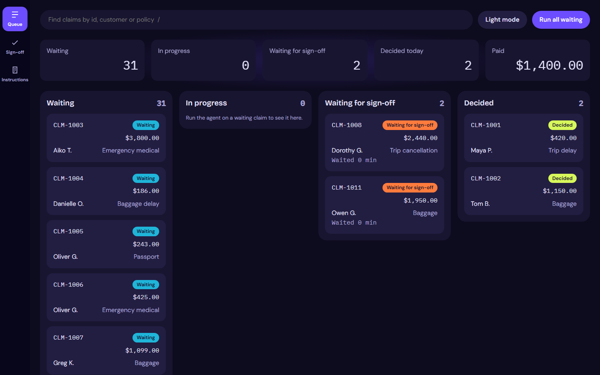
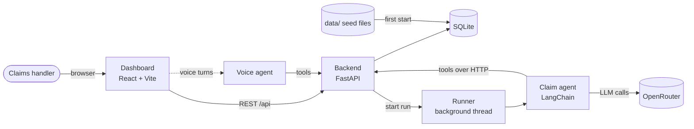
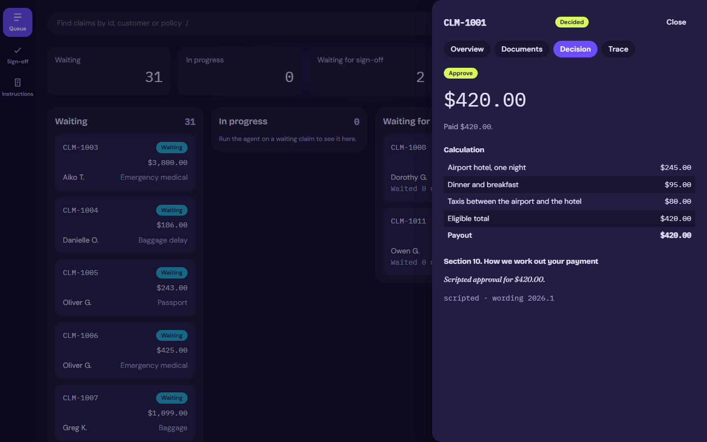
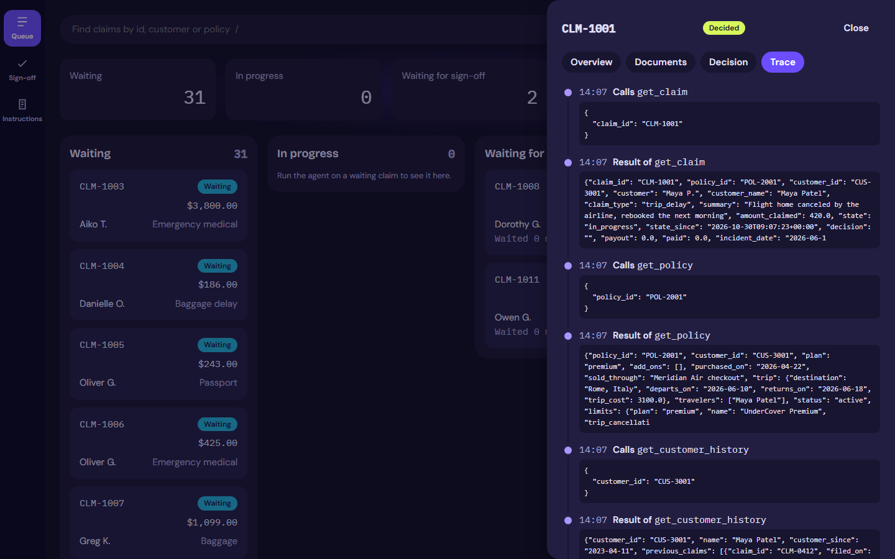
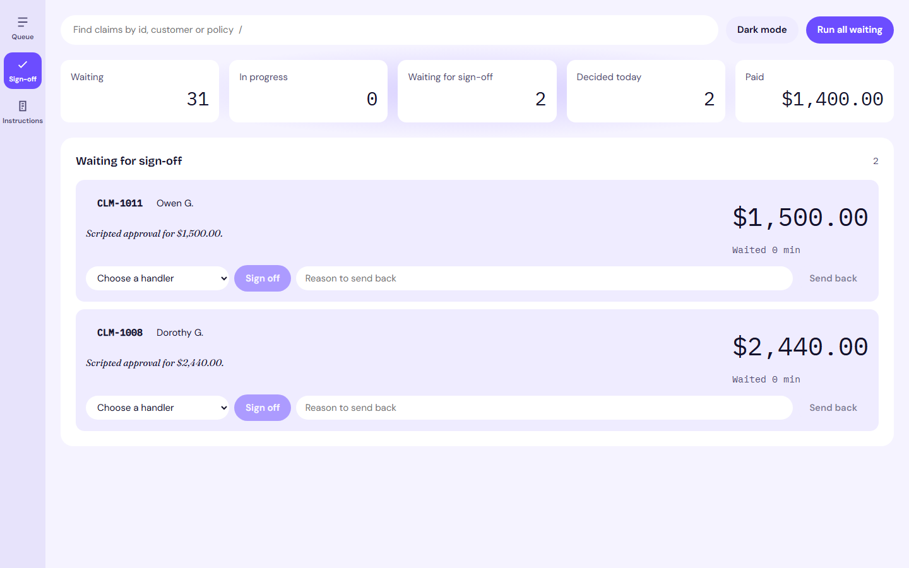
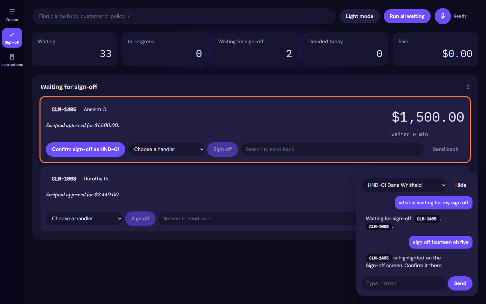

<div align="center">

# Cipher Cover

**An agentic claims platform for travel insurance: an AI agent decides claims, and handlers stay in control.**

[](https://github.com/abideenz01/Cipher-Cover/actions/workflows/ci.yml)


[](LICENSE)



</div>

---

## Contents

- [The problem](#the-problem)
- [How Cipher Cover solves it](#how-cipher-cover-solves-it)
- [End-to-end approach](#end-to-end-approach)
- [Features](#features)
- [Architecture](#architecture)
- [Tech stack](#tech-stack)
- [Getting started](#getting-started)
- [Configuration](#configuration)
- [Quality gates](#quality-gates)
- [Project structure](#project-structure)
- [Screenshots](#screenshots)
- [Documentation](#documentation)
- [Contributing](#contributing)
- [License](#license)

## The problem

A travel insurer sells cover on three plans (Economy, Premium and First), and a small team of claims handlers works through every claim by hand. For each one, a handler has to:

1. read the customer's story and supporting documents (receipts, delay letters, medical notes),
2. check them against the customer's policy, their claim history and a long policy wording,
3. decide to **approve**, **decline** or **refer** the claim,
4. work out the payout item by item, applying per-item limits, waiting periods and the excess, and
5. write down why, citing the relevant section of the wording.

This approach has four problems:

| Pain | Business impact |
|---|---|
| **Throughput** | The queue grows faster than three people can clear it, and customers wait days for simple claims. |
| **Consistency** | Two handlers can read the same wording differently, and payout arithmetic is error-prone. |
| **Auditability** | The reasoning behind a decision lives in someone's head, not in a record that can be reviewed. |
| **Risk** | Simply handing the work to an LLM would be worse: models miscalculate money, can be manipulated by text in a claim document, and can't be held accountable. |

The real requirement is therefore not "add AI". It is **straight-through processing at handler-level accuracy, with financial controls the model cannot bypass and a full audit trail.**

## How Cipher Cover solves it

Cipher Cover is an agentic claims platform. An AI agent works the queue the way a handler does, and the platform around it supplies the controls an insurer needs.

- **The agent judges, code calculates.** The agent reads the claim and decides which items are covered. The payout is then calculated deterministically from the wording's rules in integer cents by `backend/payout.py`, never by the model.
- **Hard limits, not prompts.** Any payout over **$1,000.00** is refused by the payment operation itself and waits for a handler's sign-off, with an SLA and an overdue flag. No instruction or prompt injection can get around it.
- **Every decision is explained.** Each decision records the outcome, the payout, a two- or three-sentence reason and the policy section it rests on.
- **Every step is visible.** Each tool call and model step is stored as a run event and streamed live to the console. Handlers watch the agent work, and auditors can replay it later.
- **Privacy by design.** No API operation returns a customer's email, phone, date of birth or address, so the agent never sees them.
- **Handlers stay in charge.** The console shows the queue in four states (waiting, in progress, waiting for sign-off and decided). Handlers can open any claim, read the agent's instructions, and sign off or send back large payouts, by mouse, keyboard or voice.

## End-to-end approach

The platform was delivered the way a forward deployed engineer would deliver it to a real customer: start from the business outcome, build the controls before handing the agent autonomy, and prove each step.

### 1. Discovery: understanding the work before automating it

- Mapped how handlers decide claims today, including the plans, the policy wording, the claims manual and the referral rules.
- Turned the head of claims operations' needs into a written spec ([docs/SPEC.md](docs/SPEC.md)) with explicit rules and explicit non-goals for the pilot: no real payments, no customer messaging and no sign-in.
- Defined success as **accuracy against handlers' own past decisions**. Those decisions are kept in `data/evals/` as a held-out answer key that the agent can never see.

### 2. Architecture: one API for people and agents

- A **FastAPI** backend owns the data and every business rule. Each operation has an `operation_id`, a one-line docstring and no optional inputs, so the same API is clean both for the dashboard and as a set of agent tools.
- The agent has **no database access**. It reaches claims and even its own instructions only through the API, so permissions, PII filtering and payout limits are enforced in one place.
- See [docs/ARCHITECTURE.md](docs/ARCHITECTURE.md) for the diagrams.

### 3. Agent design: narrow tools and a clear job

- A LangChain `create_agent` on OpenRouter, with **six purpose-built tools**: `get_claim`, `get_policy`, `get_customer_history`, `calculate_payout`, `record_decision` and `pay_claim`.
- Instructions live in `backend/instructions.md`, are served through the API and are shown read-only in the console, so the business can see exactly what the agent was told.
- The model is configurable (`MODEL_NAME`), so cost and quality can be traded off without code changes.

### 4. Guardrails and human in the loop

- **Deterministic money:** payout rules are plain, unit-tested Python, not model output.
- **Hard financial limit:** `pay_claim` refuses any payout over $1,000.00. Only authorised handlers can sign off, and signing off is what pays.
- **Fail safe:** a run that errors or ends without a decision is marked failed, and the claim goes back to `waiting` rather than half-processed.
- **Voice can't pay:** a voice request only highlights a claim for sign-off. A handler's click is the sign-off.

### 5. Observability: a live, replayable trace

- Agent runs execute in background threads. Every step is persisted as a run event and polled into a timeline in the claim drawer, giving handlers live visibility and auditors a permanent record.

### 6. The handler experience

- A calm, dense operations console in React and Vite: a queue board, a metric strip, a claim drawer (Overview, Documents, Decision and Trace), a sign-off view with SLA tracking, `/` to search, and dark and light themes built to WCAG AA contrast.
- Optional **voice mode** for hands-free work, with captions, a consent notice, per-session rate limiting and spoken summaries that never read out personal data.

### 7. Quality engineering: proven, not promised

- A scripted stub model (`AGENT_STUB=1`) makes every test deterministic and free to run.
- **91 Python tests at 98.7% coverage**, **27 TypeScript tests at 96.0% coverage** and **11 Playwright end-to-end tests**, all enforced by a pre-commit hook and CI.
- Validated against a real model: on claim CLM-1001 the agent approved **$420.00** under the Trip Delay section, correctly reasoning that a crew cancellation delayed departure beyond the Premium plan's six-hour waiting period.

### 8. Rollout path

The pilot proves the decision loop. The roadmap below extends it toward production: a hardened agent harness, durable state, evaluation at scale, and deployment on AWS.

> The demo data is for **UnderCover Travel Insurance**, a fictional insurer. No real customer data is used.

## Features

| Area | What it does |
|---|---|
| **Claims API** | FastAPI on SQLite, seeded from `data/` on first start. Every operation has an `operation_id` and a one-line docstring, so it doubles as a clean tool surface for agents. |
| **Claim agent** | LangChain `create_agent` on OpenRouter with six tools over the API. Runs in a background thread; a run that errors or ends without a decision returns the claim to `waiting`. |
| **Payout engine** | Deterministic limits, excesses and waiting periods (`backend/payout.py`), fully unit tested. |
| **Sign-off** | Handler sign-off and send-back for large payouts, restricted to authorised handlers, with SLA tracking. |
| **Live trace** | Each agent step is recorded as a run event and shown as a timeline in the claim drawer. |
| **Console** | A dense, keyboard-friendly operations dashboard: queue board, metric strip, claim drawer (Overview, Documents, Decision, Trace), `/` to search, dark and light themes. |
| **Voice** | Optional hands-free mode: talk to a voice agent with nine tools, with captions, consent notice and rate limiting. A voice request never pays a claim; only a handler's click does. |

## Architecture



The agent reaches claims and its own instructions **only through the backend's API**, the same surface the dashboard uses. That keeps one source of truth for permissions, PII rules and payout limits. See [docs/ARCHITECTURE.md](docs/ARCHITECTURE.md) for the full picture.

## Tech stack

| Layer | Choice |
|---|---|
| Backend | Python 3.12, FastAPI, SQLite, uv |
| Agent | LangChain `create_agent`, OpenRouter (`openai/gpt-6-luna` by default, any model via `MODEL_NAME`) |
| Dashboard | React 19, TypeScript, Vite |
| Testing | pytest, vitest, Testing Library, Playwright |
| Quality | ruff, pyright, ESLint, Prettier, tsc, lefthook pre-commit hooks |
| CI | GitHub Actions |

## Getting started

### Prerequisites

- [Python 3.12](https://www.python.org/) and [uv](https://docs.astral.sh/uv/)
- [Node.js 26](https://nodejs.org/) (see `.nvmrc`)
- An [OpenRouter](https://openrouter.ai/) API key for real agent runs (optional: the stub model needs no key)

### Install and run

```bash
git clone https://github.com/abideenz01/Cipher-Cover.git
cd Cipher-Cover

uv sync                 # Python dependencies
npm install             # Node dependencies, Playwright browser and git hooks

cp .env.example .env    # then add your OPENROUTER_API_KEY

npm run dev             # backend on :8000, dashboard on :5173
```

Open <http://localhost:5173>. The database (`undercover.db`) is created and seeded from `data/` on first start.

> **No API key?** Set `AGENT_STUB=1` to use a scripted model, or set `MODEL_NAME=openrouter/free` to use a free model.

### Useful commands

| Command | Purpose |
|---|---|
| `npm run dev` | Start the backend and dashboard with hot reload |
| `npm run check` | Run every check (Python, TypeScript and end-to-end) |
| `npm run format` | Format Python and TypeScript |
| `npm run e2e` | Playwright end-to-end tests only |
| `uv run -m backend.seed --reset` | Rebuild the database from `data/` |

## Configuration

All settings live in `.env` (see [`.env.example`](.env.example)).

| Variable | Default | Description |
|---|---|---|
| `OPENROUTER_API_KEY` | | OpenRouter key for the agent |
| `MODEL_NAME` | `openai/gpt-6-luna` | Model for the claim agent |
| `AGENT_STUB` | `0` | `1` swaps in the scripted model (tests and demos) |
| `DB_PATH` | `undercover.db` | SQLite database file |
| `VOICE_ENABLED` | `0` | `1` turns on the voice operations and the mic |
| `VOICE_PROVIDER` | `browser` | `browser` (Chrome or Edge), or `stub` for tests |
| `VOICE_MODEL_NAME` | | Model for the voice agent |
| `VOICE_TURNS_PER_MINUTE` | `20` | Per-session voice rate limit |

## Quality gates

Every commit runs formatting, linting, type checks and unit tests through a lefthook pre-commit hook, and CI runs the full suite on every push and pull request.

| Suite | Tools | Bar |
|---|---|---|
| Python | ruff, pyright, pytest | 80% coverage minimum |
| TypeScript | ESLint, Prettier, tsc, vitest | 80% coverage minimum |
| End to end | Playwright on a fresh database with the stub agent | All pass |

## Project structure

```text
Cipher-Cover/
├── .github/            # CI workflow, issue and PR templates, Dependabot
├── agent/              # Claim agent and voice agent (LangChain), with scripted stubs
│   └── tests/
├── backend/            # FastAPI app: claims, payout, decisions, sign-off, runs
│   ├── voice/          # Voice operations (off unless VOICE_ENABLED=1)
│   └── tests/
├── context/            # Business rules, glossary, data dictionary, policy wording
├── dashboard/          # React + Vite operations console
│   └── src/
│       ├── components/ # Board, drawer, timeline, command bar, metric strip
│       ├── views/      # Sign-off and Instructions views
│       └── voice/      # Mic, captions and speech providers
├── data/               # Seed data for the demo insurer (evals/ is the answer key)
├── docs/               # Spec, architecture, tech stack, standards, brand, plans
│   └── screens/        # Dashboard screenshots
├── e2e/                # Playwright tests
├── .env.example        # Environment template
├── package.json        # Node scripts and dependencies
└── pyproject.toml      # Python dependencies and tool config
```

## Screenshots

| Claim drawer | Live trace |
|---|---|
|  |  |
| **Sign-off (light)** | **Voice** |
|  |  |

## Documentation

| Document | What's in it |
|---|---|
| [docs/SPEC.md](docs/SPEC.md) | What the business needs |
| [docs/ARCHITECTURE.md](docs/ARCHITECTURE.md) | How the parts fit together |
| [docs/TECH_STACK.md](docs/TECH_STACK.md) | Technology choices |
| [docs/CODE_STANDARDS.md](docs/CODE_STANDARDS.md) | How the code is written |
| [docs/PROCESS.md](docs/PROCESS.md) | How work is planned, built and checked |
| [docs/BRAND.md](docs/BRAND.md) | The console's look and feel |
| [docs/STATUS.md](docs/STATUS.md) | What's built and how to run it |
| [docs/PLAN.md](docs/PLAN.md) | The build plan, phase by phase |

## Roadmap

- [x] Claims API, payout engine and claim agent
- [x] Handler sign-off with SLA tracking
- [x] Live agent trace and operations console
- [x] Voice mode
- [ ] Agent harness: middleware and guardrails
- [ ] Durable state and human-in-the-loop with LangGraph
- [ ] Evaluations and a multi-agent dispatcher
- [ ] Production deployment on AWS

## Contributing

Contributions are welcome. Please read [CONTRIBUTING.md](CONTRIBUTING.md) and our [Code of Conduct](CODE_OF_CONDUCT.md) first. To report a vulnerability, see [SECURITY.md](SECURITY.md).

## Author

Designed and built by **Zain** ([@abideenz01](https://github.com/abideenz01)).

## License

Released under the [MIT License](LICENSE).
