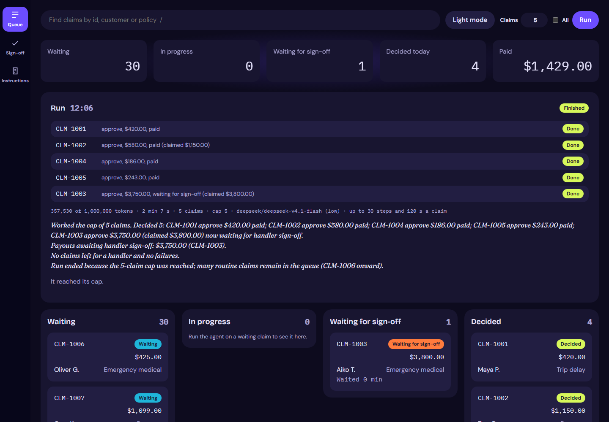
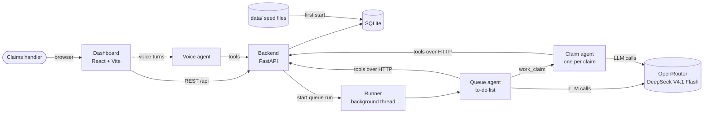
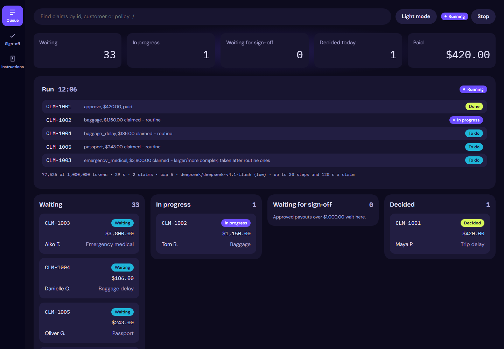
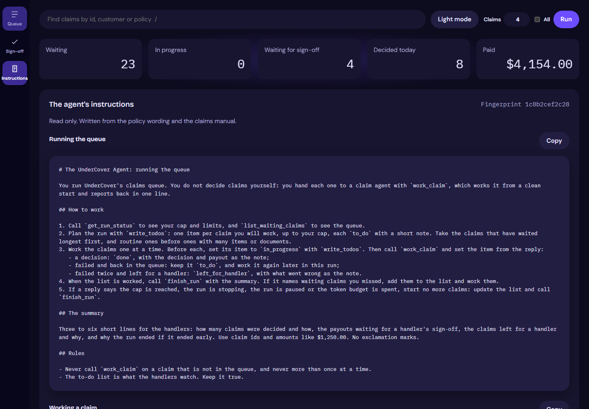

<div align="center">

# Cipher Cover

**An agentic claims platform for travel insurance: an AI agent works the claims queue, and handlers stay in control.**

[](https://github.com/abideenz01/Cipher-Cover/actions/workflows/ci.yml)


[](LICENSE)



</div>

---

## Contents

- [The problem](#the-problem)
- [How Cipher Cover solves it](#how-cipher-cover-solves-it)
- [What's new: the agent harness](#whats-new-the-agent-harness)
- [End-to-end approach](#end-to-end-approach)
- [Features](#features)
- [Architecture](#architecture)
- [Tech stack](#tech-stack)
- [Getting started](#getting-started)
- [Configuration](#configuration)
- [Quality gates](#quality-gates)
- [Project structure](#project-structure)
- [Screenshots](#screenshots)
- [Documentation](#documentation)
- [Roadmap](#roadmap)
- [Contributing](#contributing)
- [License](#license)

## The problem

A travel insurer sells cover on three plans (Economy, Premium and First), and a small team of claims handlers works through every claim by hand. For each one, a handler has to:

1. read the customer's story and supporting documents (receipts, delay letters, medical notes),
2. check them against the customer's policy, their claim history, a long policy wording and the claims manual,
3. decide to **approve**, **decline** or **refer** the claim,
4. work out the payout item by item, applying per-item limits, waiting periods and the excess, and
5. write down why, citing the relevant sections of the wording.

This approach has four problems:

| Pain | Business impact |
|---|---|
| **Throughput** | The queue grows faster than three people can clear it, and customers wait days for simple claims. |
| **Consistency** | Two handlers can read the same wording differently, and payout arithmetic is error-prone. |
| **Auditability** | The reasoning behind a decision lives in someone's head, not in a record that can be reviewed. |
| **Risk** | Simply handing the work to an LLM would be worse: models miscalculate money, can be manipulated by text in a claim document, can loop or run up costs, and can't be held accountable. |

The real requirement is therefore not "add AI". It is **straight-through processing at handler-level accuracy, with financial controls the model cannot bypass, limits on what a run can cost, and a full audit trail.**

## How Cipher Cover solves it

Cipher Cover is an agentic claims platform. An AI agent works the queue the way a handler does, and the platform around it, its **harness**, supplies the controls an insurer needs.

- **The agent works the queue, not one claim.** A queue agent plans a run as a to-do list, hands each claim to a fresh claim agent, and ends with a summary for the handlers.
- **The agent judges, code calculates.** The claim agent decides which items are covered. The payout is calculated deterministically from the wording's rules in integer cents by `backend/payout.py`, never by the model.
- **Decisions rest on what was read.** The claim agent looks up only the sections of the wording and the claims manual it needs. A decision must cite sections, and the backend refuses one that cites a section the agent never read.
- **Hard limits, not prompts.** Any payout over **$1,000.00** is refused by the payment operation itself and waits for a handler's sign-off. Each claim has a step and time limit, each run a token limit, and a handler can press **Stop** at any time.
- **Problems put right automatically.** Provider errors are retried, a failed claim goes back in the queue, and a claim that fails twice is left for a handler.
- **Every step is visible.** Each tool call, model step, section read and token count is stored and shown live in the console, so handlers watch the agent work and auditors can replay it later.
- **Privacy by design.** No API operation returns a customer's email, phone, date of birth or address, so the agent never sees them.
- **Handlers stay in charge.** Handlers can open any claim, read both agents' instructions, and sign off or send back large payouts, by mouse, keyboard or voice.

## What's new: the agent harness

The latest release turns the pilot's "decide the claim you're given" agent into one that works the whole queue safely, with no change of model ([docs/HARNESS.md](docs/HARNESS.md), [docs/PLAN_HARNESS.md](docs/PLAN_HARNESS.md)).

| Area | What changed |
|---|---|
| **Queue agent** | A new agent (`agent/queue.py`) plans the run with a to-do list, works each claim through a fresh claim agent, and finishes with a summary. It has no tool to decide or pay. |
| **Section lookup** | The wording and the claims manual are split into sections (`wording-5`, `manual-9`). The claim agent reads only what it needs with `list_sections` and `read_section`, and every read is recorded. |
| **Checked decisions** | `record_decision` refuses an empty reason, no cited sections, or a cited section the run never read. The Decision tab lists the sections relied on. |
| **Budgets** | A step limit and time limit on each claim, and a token limit on each run. |
| **Retries** | Provider errors are retried with backoff. After several failures in a row the run pauses rather than switching models. |
| **Leases and recovery** | One run at a time and a lease on each claim, so no claim is worked twice. On restart, claims left in progress return to the queue. |
| **Safe to repeat** | Deciding and paying are idempotent: a retried step never pays twice. |
| **Scoped writes** | Each claim agent can only write to its own claim, through a live run on that claim. |
| **Audit trail** | Each run records its model, limits, instructions fingerprint, tokens, time, attempts and run history. |
| **Stop** | A Stop button ends the run after the claim in hand. |
| **Console** | A run control (claims cap, All, Run and Stop), a run panel with the live to-do list and usage, run history, a "Left for a handler" chip, and a trace grouped by attempt. |
| **Voice** | The voice assistant looks claims up by the handler's own words, so "ten oh two" finds CLM-1002. |

## End-to-end approach

The platform was delivered the way a forward deployed engineer would deliver it to a real customer: start from the business outcome, build the controls before handing the agent autonomy, and prove each step.

### 1. Discovery: understanding the work before automating it

- Mapped how handlers decide claims today, including the plans, the policy wording, the claims manual and the referral rules.
- Turned the head of claims operations' needs into a written spec ([docs/SPEC.md](docs/SPEC.md)) with explicit rules and explicit non-goals: no real payments, no customer messaging and no sign-in.
- Defined success as **accuracy against handlers' own past decisions**. Those decisions are kept in `data/evals/` as a held-out answer key that the agent can never see.

### 2. Architecture: one API for people and agents

- A **FastAPI** backend owns the data and every business rule. Each operation has an `operation_id`, a one-line docstring and no optional inputs, so the same API is clean both for the dashboard and as a set of agent tools.
- The agents have **no database access**. They reach claims, documents and even their own instructions only through the API, so permissions, PII filtering, budgets and payout limits are enforced in one place.
- See [docs/ARCHITECTURE.md](docs/ARCHITECTURE.md) for the diagrams.

### 3. Agent design: two agents, narrow tools, clear jobs

- A **queue agent** with five tools: `get_run_status`, `list_waiting_claims`, `write_todos`, `work_claim` and `finish_run`.
- A **claim agent** with eight tools: `get_claim`, `get_policy`, `get_customer_history`, `list_sections`, `read_section`, `calculate_payout`, `record_decision` and `pay_claim`.
- Both are LangChain `create_agent` agents on OpenRouter, defaulting to **DeepSeek V4.1 Flash** with low reasoning effort. The model is configurable (`MODEL_NAME`), so cost and quality can be traded off without code changes.
- Instructions live in `backend/instructions_queue.md` and `backend/instructions_claim.md`, are served through the API, and are shown read-only in the console with a fingerprint that every run records.

### 4. The harness: guardrails, budgets and recovery

- **Deterministic money:** payout rules are plain, unit-tested Python, not model output.
- **Hard financial limit:** `pay_claim` refuses any payout over $1,000.00. Only authorised handlers can sign off, and signing off is what pays.
- **Evidence-checked decisions:** a decision must cite sections the run actually read.
- **Budgets:** `ModelCallLimitMiddleware` caps model calls per claim, a timeout caps time per claim, and a token limit caps each run.
- **Retries and pauses:** `ModelRetryMiddleware` retries provider errors; repeated failures pause the run.
- **Fail safe:** a claim run that errors or ends without a decision returns its claim to `waiting`; after two failures it is left for a handler.
- **Leases and startup recovery:** a claim is leased in one conditional update, and a restart frees anything left in progress.
- **Voice can't pay:** a voice request only highlights a claim for sign-off. A handler's click is the sign-off.

### 5. Observability: a live, replayable trace

- Runs execute in background threads. Every step, section read and token count is persisted and polled into the console: a run panel with the to-do list and usage, and a claim trace grouped by attempt.

### 6. The handler experience

- A calm, dense operations console in React and Vite: a run control and run panel, a queue board, a metric strip, a claim drawer (Overview, Documents, Decision and Trace), a sign-off view with SLA tracking, `/` to search, and dark and light themes built to WCAG AA contrast.
- Optional **voice mode** for hands-free work, with captions, a consent notice, per-session rate limiting and spoken summaries that never read out personal data.

### 7. Quality engineering: proven, not promised

- Scripted stub models (`AGENT_STUB=1`) make every test deterministic and free to run, including faulty models that raise provider errors, loop or cite unread sections.
- **128 Python tests at 99% coverage**, **32 TypeScript tests at 96.5% coverage** and **14 Playwright end-to-end tests**, all enforced by a pre-commit hook and CI.
- Validated against a real model: a queue run capped at 5 claims on DeepSeek V4.1 Flash worked all 5 on the first attempt in **2 min 7 s** with **357,530 tokens**. It paid four approvals ($420.00, $580.00, $186.00 and $243.00) and left a $3,750.00 approval waiting for a handler's sign-off. No claim was decided or paid twice.

### 8. Rollout path

The harness makes the agent safe to run on the whole queue. The roadmap below extends it toward production: durable state, evaluation at scale, and deployment on AWS.

> The demo data is for **UnderCover Travel Insurance**, a fictional insurer. No real customer data is used.

## Features

| Area | What it does |
|---|---|
| **Claims API** | FastAPI on SQLite, seeded from `data/` on first start. Every operation has an `operation_id` and a one-line docstring, so it doubles as a clean tool surface for agents. |
| **Queue runs** | Start a run on a set number of claims or all of them. One run at a time, with a to-do list, a cap, budgets, Stop, run history and recovery on restart. |
| **Queue agent** | Plans the run, hands each claim to a fresh claim agent, and writes a summary. It cannot decide or pay. |
| **Claim agent** | Eight tools over the API, section-by-section reading of the wording and manual, retries, and step and time limits. |
| **Payout engine** | Deterministic limits, excesses and waiting periods (`backend/payout.py`), fully unit tested. |
| **Decision checks** | A decision needs a reason and cited sections the run has read; deciding and paying are safe to repeat. |
| **Sign-off** | Handler sign-off and send-back for large payouts, restricted to authorised handlers, with SLA tracking. |
| **Live trace** | Each step is recorded and shown in the claim drawer, grouped by attempt with tokens, time and sections read. |
| **Console** | Run control and run panel, queue board, metric strip, claim drawer, Instructions view with fingerprint, `/` to search, dark and light themes. |
| **Voice** | Optional hands-free mode: talk to a voice agent with nine tools, with captions, consent notice and rate limiting. A voice request never pays a claim; only a handler's click does. |

## Architecture



The agents reach claims, documents and their own instructions **only through the backend's API**, the same surface the dashboard uses. That keeps one source of truth for permissions, PII rules, budgets and payout limits. See [docs/ARCHITECTURE.md](docs/ARCHITECTURE.md) for the full picture.

## Tech stack

| Layer | Choice |
|---|---|
| Backend | Python 3.12, FastAPI, SQLite, uv |
| Agents | LangChain `create_agent` with `ModelRetryMiddleware` and `ModelCallLimitMiddleware`, on OpenRouter (`deepseek/deepseek-v4.1-flash` by default, any model via `MODEL_NAME`) |
| Dashboard | React 19, TypeScript, Vite |
| Testing | pytest, vitest, Testing Library, Playwright |
| Quality | ruff, pyright, ESLint, Prettier, tsc, lefthook pre-commit hooks |
| CI | GitHub Actions |

## Getting started

### Prerequisites

- [Python 3.12](https://www.python.org/) and [uv](https://docs.astral.sh/uv/)
- [Node.js 26](https://nodejs.org/) (see `.nvmrc`)
- An [OpenRouter](https://openrouter.ai/) API key for real agent runs (optional: the stub models need no key)

### Install and run

```bash
git clone https://github.com/abideenz01/Cipher-Cover.git
cd Cipher-Cover

uv sync                 # Python dependencies
npm install             # Node dependencies, Playwright browser and git hooks

cp .env.example .env    # then add your OPENROUTER_API_KEY

npm run dev             # backend on :8000, dashboard on :5173
```

Open <http://localhost:5173> and sign in, then set the number of claims in the command bar and press **Run**. The database (`undercover.db`) is created and seeded from `data/` on first start.

> **Signing in.** The first start seeds two fictional insurers. UnderCover has seven demo sign-ins: one per handler in `data/handlers.json` (for example `dana.whitfield@undercover.example`, a senior handler who can sign off), plus `admin@undercover.example` and `auditor@undercover.example`. Acme Travel Cover (`data/tenants/acme/`, 10 claims) has `ada.okonkwo@acme.example` and three more. Neither insurer can see the other's claims. Set `DEMO_PASSWORD` in `.env` before that first start to give them all that password. Otherwise each gets a random password, printed once in the backend's output. To start again, stop the backend and run `uv run -m backend.seed --reset`.

> **Upgrading?** A database from the harness is migrated in place on startup: it gains tenants, sign-ins and the security log, and keeps its claims and decisions. A database from the pilot must be rebuilt with `uv run -m backend.seed --reset`.

> **No API key?** Set `AGENT_STUB=1` to use the scripted models, or set `MODEL_NAME=openrouter/free` to use a free model.

You can also start a run from the command line, with a session token as a bearer token:

```bash
TOKEN=$(curl -s -c - http://127.0.0.1:8000/api/auth/login -H "Content-Type: application/json"   -d '{"email": "dana.whitfield@undercover.example", "password": "..."}' | awk '/cc_session/ {print $7}')
curl -X POST http://127.0.0.1:8000/api/runs -H "Authorization: Bearer $TOKEN"   -H "Content-Type: application/json" -d '{"cap": 5}'
```

### Useful commands

| Command | Purpose |
|---|---|
| `npm run dev` | Start the backend and dashboard with hot reload |
| `npm run check` | Run every check (Python, TypeScript and end-to-end) |
| `npm run format` | Format Python and TypeScript |
| `npm run e2e` | Playwright end-to-end tests only |
| `uv run -m backend.seed --reset` | Rebuild the database from `data/` |

## Configuration

All settings live in `.env` (see [`.env.example`](.env.example)).

| Variable | Default | Description |
|---|---|---|
| `OPENROUTER_API_KEY` | | OpenRouter key for the agents |
| `MODEL_NAME` | `deepseek/deepseek-v4.1-flash` | Model for the queue and claim agents |
| `AGENT_STUB` | `0` | `1` swaps in the scripted models (tests and demos) |
| `DB_PATH` | `undercover.db` | SQLite database file |
| `CLAIM_STEP_LIMIT` | `30` | Model calls allowed on one claim |
| `RUN_TOKEN_LIMIT` | `1000000` | Tokens allowed in one queue run |
| `PROVIDER_FAILURES_TO_PAUSE` | `3` | Provider failures in a row before a run pauses |
| `MODEL_TIMEOUT_SECONDS` | `60` | Timeout on one model call |
| `VOICE_ENABLED` | `0` | `1` turns on the voice operations and the mic |
| `VOICE_PROVIDER` | `browser` | `browser` (Chrome or Edge), or `stub` for tests |
| `VOICE_MODEL_NAME` | | Model for the voice agent (defaults to `MODEL_NAME`) |
| `VOICE_TURNS_PER_MINUTE` | `20` | Per-session voice rate limit |
| `DEMO_PASSWORD` | | Password for every demo sign-in when the database is first seeded; random ones are printed if unset |
| `COOKIE_SECURE` | `1` | `0` sends the session cookie over plain http (only needed off localhost) |
| `SESSION_IDLE_MINUTES` | `30` | A session ends after this long without a request |
| `SESSION_HOURS` | `12` | A session ends this long after sign-in, however busy |
| `API_DOCS` | `0` | `1` serves `/docs` and `/openapi.json`, which are outside the sign-in check |

The time allowed on one claim is `agent_run_timeout_seconds` (120) in `data/company.json`.

## Quality gates

Every commit runs formatting, linting, type checks and unit tests through a lefthook pre-commit hook, and CI runs the full suite on every push and pull request.

| Suite | Tools | Bar | Current |
|---|---|---|---|
| Python | ruff, pyright, pytest | 80% coverage minimum | 128 tests, 99% |
| TypeScript | ESLint, Prettier, tsc, vitest | 80% coverage minimum | 32 tests, 96.5% |
| End to end | Playwright on a fresh database with the stub agents | All pass | 14 of 14 |

## Project structure

```text
Cipher-Cover/
├── .github/            # CI workflow, issue and PR templates, Dependabot
├── agent/              # Queue agent, claim agent and voice agent (LangChain), with scripted stubs
│   └── tests/
├── backend/            # FastAPI app: claims, sections, payout, decisions, sign-off, runs, queue runs
│   ├── voice/          # Voice operations (off unless VOICE_ENABLED=1)
│   └── tests/
├── context/            # Business rules, glossary, data dictionary, policy wording
├── dashboard/          # React + Vite operations console
│   └── src/
│       ├── components/ # Board, drawer, run panel, timeline, command bar, metric strip
│       ├── views/      # Sign-off and Instructions views
│       └── voice/      # Mic, captions and speech providers
├── data/               # Seed data for the demo insurer (evals/ is the answer key)
├── docs/               # Spec, harness brief and plan, architecture, standards, brand, status
│   └── screens/        # Dashboard screenshots
├── e2e/                # Playwright tests
├── .env.example        # Environment template
├── package.json        # Node scripts and dependencies
└── pyproject.toml      # Python dependencies and tool config
```

## Screenshots

| Queue run in progress | Claim trace by attempt |
|---|---|
|  |  |
| **Decision with sections relied on** | **Instructions with fingerprint** |
|  |  |
| **Sign-off (light)** | **Voice** |
|  |  |

## Documentation

| Document | What's in it |
|---|---|
| [docs/SPEC.md](docs/SPEC.md) | What the business needs |
| [docs/HARNESS.md](docs/HARNESS.md) | The brief for the agent harness, with its production requirements |
| [docs/PLAN_HARNESS.md](docs/PLAN_HARNESS.md) | The harness build plan, phase by phase |
| [docs/ARCHITECTURE.md](docs/ARCHITECTURE.md) | How the parts fit together |
| [docs/TECH_STACK.md](docs/TECH_STACK.md) | Technology choices |
| [docs/CODE_STANDARDS.md](docs/CODE_STANDARDS.md) | How the code is written |
| [docs/PROCESS.md](docs/PROCESS.md) | How work is planned, built and checked |
| [docs/BRAND.md](docs/BRAND.md) | The console's look and feel |
| [docs/STATUS.md](docs/STATUS.md) | What's built, how to run it, and the results of manual checks |
| [docs/PLAN.md](docs/PLAN.md) | The pilot's build plan |

## Roadmap

- [x] Claims API, payout engine and claim agent
- [x] Handler sign-off with SLA tracking
- [x] Live agent trace and operations console
- [x] Voice mode
- [x] Agent harness: queue agent, section lookup, budgets, retries, leases, checked decisions, audit trail and Stop
- [ ] Durable state and human-in-the-loop with LangGraph
- [ ] Evaluations and a multi-agent dispatcher
- [ ] Production deployment on AWS

## Contributing

Contributions are welcome. Please read [CONTRIBUTING.md](CONTRIBUTING.md) and our [Code of Conduct](CODE_OF_CONDUCT.md) first. To report a vulnerability, see [SECURITY.md](SECURITY.md).

## Author

Designed and built by **Zain** ([@abideenz01](https://github.com/abideenz01)).

## License

Released under the [MIT License](LICENSE).
