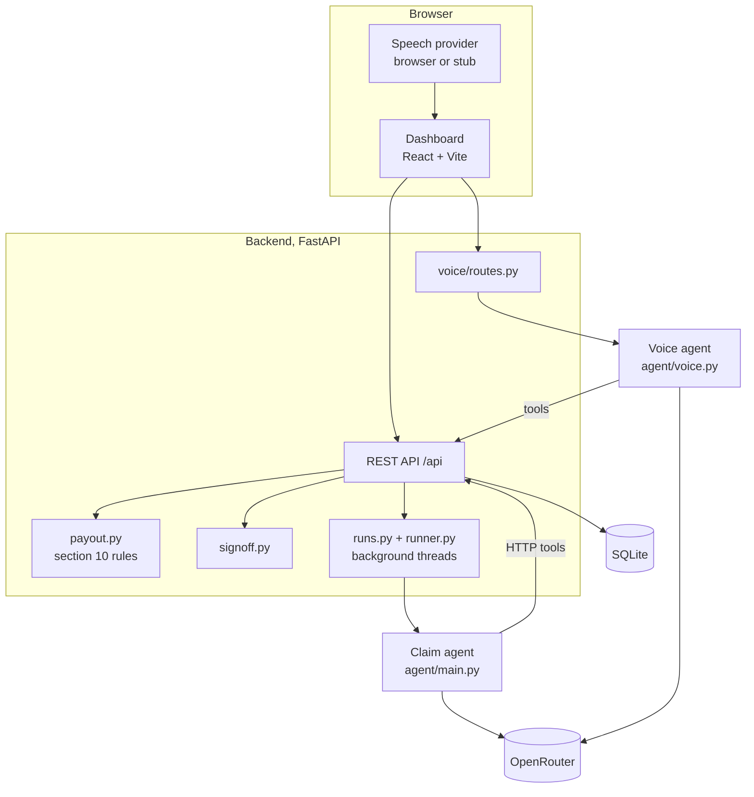
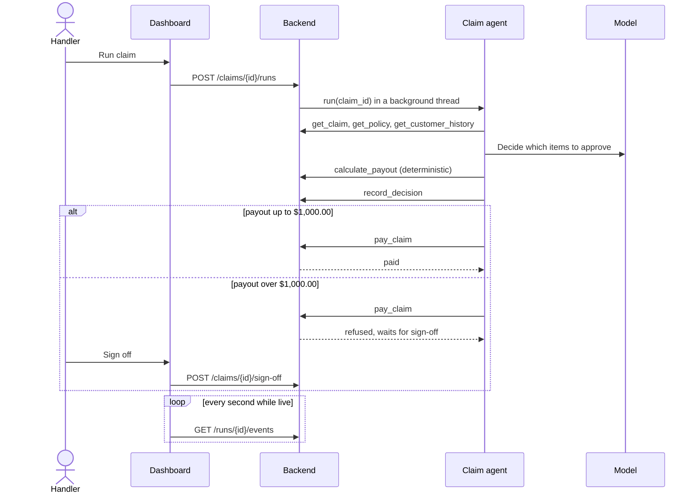

# Architecture

Cipher Cover has three parts: a FastAPI backend that owns the data and every business rule, a claim agent that decides claims through the backend's API, and a React console for claims handlers.

## Components

| Part | Path | Responsibility |
|---|---|---|
| Backend | `backend/` | Data, business rules, permissions and PII filtering. Seeds SQLite from `data/` on startup. |
| Claim agent | `agent/main.py` | `run(claim_id, thread_id, llm=None, on_step=None)`: reads the claim, decides, calculates and pays through six tools. |
| Voice agent | `agent/voice.py` | `run_turn(session_id, handler_id, text, llm=None, token="")`: answers spoken questions with nine tools, under a voice token for the signed-in handler. |
| Dashboard | `dashboard/` | The handlers' console: queue, sign-off, instructions, trace and voice. |
| Context | `context/` | Policy wording, claim rules, glossary and data dictionary. |

## The life of a claim

## Agent tools

| Tool | API operation | Purpose |
|---|---|---|
| `get_claim` | `GET /claims/{claim_id}` | The claim, its items and documents |
| `get_policy` | `GET /policies/{policy_id}` | The plan, limits and excess |
| `get_customer_history` | `GET /customers/{customer_id}/history` | Earlier claims, without personal data |
| `calculate_payout` | `POST /claims/{claim_id}/calculate` | Applies section 10 of the wording |
| `record_decision` | `POST /claims/{claim_id}/decision` | Approve, decline or refer, with the payout, reason and policy section |
| `pay_claim` | `POST /claims/{claim_id}/pay` | Pays up to $1,000.00; larger amounts wait for sign-off |

## Sign-in, tenants and agent tokens

`backend/auth.py` runs `guard` on every route, because it is set on the whole app. It finds the caller and checks that `backend/permissions.py` lets them call the route's operation. Only `health`, `login` and `get_public_config` are open, and `/docs` and `/openapi.json` are off unless `API_DOCS=1`.

| Caller | How they prove it | What they may call |
|---|---|---|
| A person | A session from `login`: an HttpOnly, SameSite=Strict cookie plus a CSRF token on every write, or the session token as a bearer token | Their roles' operations, in their own tenant |
| Claim agent | A service token issued when its run starts | Its eight tools, on its own claim, policy and customer only |
| Queue agent | A service token issued when its queue run starts | Its tools, on its own queue run and the claim runs it leased |
| Voice agent | A service token issued for one turn | The voice tools that the person it acts for may also call |

- Passwords are scrypt hashes. Session and service tokens are stored only as SHA-256 hashes.
- A claim token ends with its run, and every agent token ends when the backend restarts.
- `backend/accounts.py` lets a tenant admin add sign-ins, change roles, turn sign-ins off and on, and set whether medical documents may go to the model, all within their own tenant.
- `security_events` records sign-ins, sign-outs, refusals, CSRF failures, sign-offs, send-backs, sign-off requests and tokens issued.
- Every business table has a `tenant_id`, and every query filters by the caller's tenant. This is application-level isolation on SQLite, for development and pilots. Production with more than one tenant needs PostgreSQL with row-level security first (`docs/ADR_POSTGRES.md`).
- `get_claim` replaces the text of medical records and medical bills for agents unless the tenant's config sets `external_model_medical`. Agents see a customer's first name and last initial only. Traveler names on a policy still reach the model, because coverage depends on them.

## Design decisions

- **One API for people and agents.** The agent has no database access. Sign-in, permissions, tenant isolation, PII filtering and payout limits are enforced once, in the backend.
- **Agents act under their run's token.** The backend issues the token, so an agent cannot widen what it may do, and a person cannot record a decision or pay a claim.
- **The model decides, code calculates.** Money is computed by `backend/payout.py` in integer cents, never by the model.
- **A hard limit, not a prompt.** The $1,000.00 sign-off limit is enforced by `pay_claim`, so no instruction or prompt injection can bypass it.
- **Fail safe.** A run that raises or ends without a decision is marked failed and the claim returns to `waiting`.
- **Testable without a model.** `AGENT_STUB=1` and the voice stub make every test deterministic and free.
- **Voice can't pay.** `request_signoff` only highlights a claim for 10 minutes; the handler's click is the sign-off.
